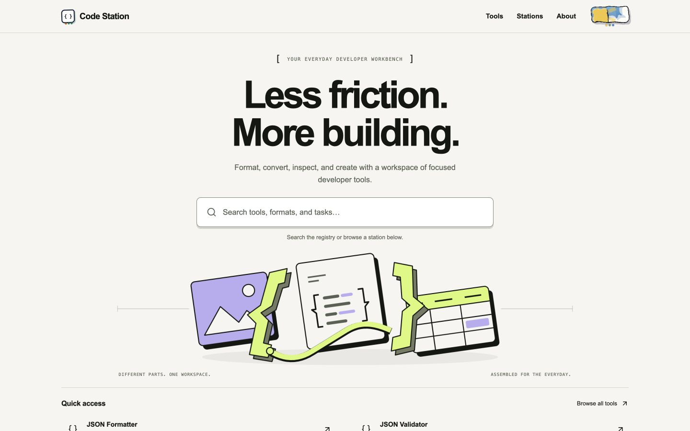
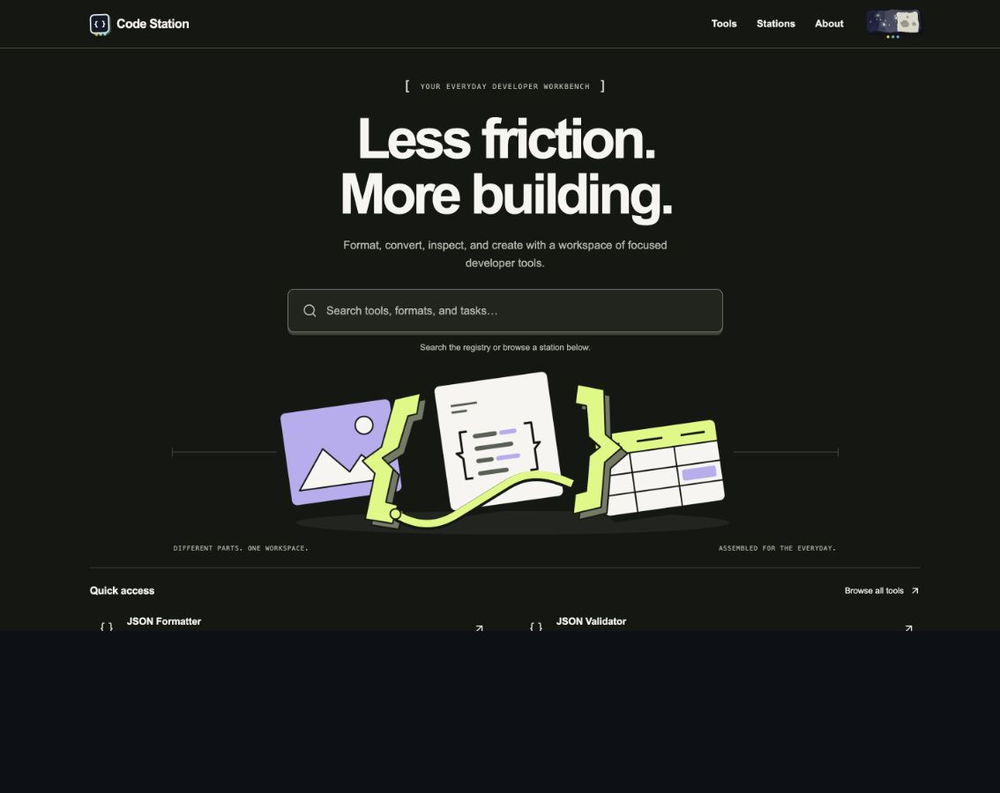

# Code Station

[](https://github.com/tejreddym/codestation/actions/workflows/ci.yml)
[](https://www.npmjs.com/package/codestation-mcp)
[](LICENSE)

Code Station is a browser-first developer toolbox featuring **383 utilities (380+)** across **30 specialized stations** for formatting, converting, hashing, inspecting, compressing, and generating data — **100% locally in the browser** with zero server uploads or accounts required.

- **Web App:** [codestation.in](https://codestation.in)
- **WebMCP Native Integration:** Supported tools expose the browser-native `document.modelContext` protocol so AI browser agents can discover and execute utilities directly on the page.
- **Local MCP Server (`codestation-mcp` v1.2.1):** Connect local developer utilities directly to Claude Desktop, Cursor, and MCP-compatible agents (`npx codestation-mcp`).

## Visual Overview

| Light Mode | Dark Mode |
| --- | --- |
|  |  |

## Getting Started

Requirements: **Node.js `>=22.13.0 <23`** (validated with `22.19.0` via `.nvmrc`) and **npm `10.x`** (`10.9.3`).

```bash
npm ci
npm run dev
```

Checks:
- `npm run lint` — ESLint checks (completes with the project's existing warnings; do not introduce new warnings or errors)
- `npm run audit:ui` — validates design tokens in `app/styles/tokens.css` (`0` errors required)
- `npm run typecheck` — strict TypeScript check (`tsc --noEmit`)
- `npm test` — Vitest unit, component, and registry contract suites
- `npm run build` — copies self-hosted PDF.js assets, builds Next.js, and generates the offline manifest

> Stop any active `next dev` / `next start` server using `.next` before running `npm run build`. To preview a finished build: `npm run start -- -p 3001`.

### Local MCP Server (`codestation-mcp` v1.2.1)

The companion MCP package lives in [`packages/codestation-mcp`](packages/codestation-mcp/package.json) (`codestation-mcp` v1.2.1):

```bash
npm run build:mcp
npm run mcp
```

## Stations & Highlights

Code Station organizes **383 tools across 30 stations**, including:
- **JSON & Data, Encoding, Text, Regex, SQL & Database, Spreadsheet, Markdown, YAML/XML/TOML**
- **Security, WebPKI & Advanced Cryptography, Compression & Archives (ZIP/TAR/Gzip)**
- **PDF & Video Studios** — client-side PDF merge, split, rotate, watermark, reorder, compress (`pdf-compressor`), video thumbnail & Canva-style overlay editor (`video-thumbnail-generator`), and browser-side video trimmer (`video-trimmer`)
- **Date & Time, Cron, Color & CSS, Frontend CSS Playground, Code Generation, Network & DevOps, Developer Math, Git & Version Control, Finance & Calculators, Productivity (Pomodoro & Invoice Generator)**

For full Date & Time conventions, see [`docs/DATE_TIME_STATION.md`](docs/DATE_TIME_STATION.md). Run just the Date & Time station suite with:
`npm test -- lib/tools/date-time-station.test.ts config/date-time-tools.test.ts components/DateTimeStation.test.tsx`.

## Project Context

- [`AGENTS.md`](AGENTS.md) — working rules for contributors and agents
- [`PROJECT_STATUS.md`](PROJECT_STATUS.md) — current state and known gaps
- [`HANDOFF.md`](HANDOFF.md) — resumable handoff
- [`TODO.md`](TODO.md) — prioritized work
- [`docs/ARCHITECTURE.md`](docs/ARCHITECTURE.md) — intended boundaries
- [`docs/DECISIONS.md`](docs/DECISIONS.md) — recorded decisions
- [`docs/archive/HISTORICAL_LOGS.md`](docs/archive/HISTORICAL_LOGS.md) — archived session & milestone logs

## Environment

Copy `.env.example` to `.env.local` when local configuration is needed. `NEXT_PUBLIC_SITE_URL` controls canonical URLs and sitemap output. The confirmed production value is `https://codestation.in`; supply this value to production builds as well as local configuration. Do not commit secrets.

## Cloudflare Deployment

The production target is Cloudflare Workers through the OpenNext adapter. The repository includes `wrangler.jsonc`, `open-next.config.ts`, and `npm run preview`, `npm run deploy`, and `npm run upload` commands. Read [`docs/CLOUDFLARE_DEPLOYMENT.md`](docs/CLOUDFLARE_DEPLOYMENT.md) before connecting Workers Builds or the `codestation.in` custom domain.

## Contributing, Security & Licensing

- **Contributing:** See [`CONTRIBUTING.md`](CONTRIBUTING.md) for setup, verification commands, and how to add a tool via `lib/engine/`.
- **Security:** See [`SECURITY.md`](SECURITY.md) for responsible disclosure, response SLAs, and scope.

### Licensing

Code Station uses a dual **Open-Core** license model:
- **Browser Tools & Web App ([`LICENSE`](LICENSE) — MIT):** All **383 browser-local tools**, stations, UI components, WebMCP integration, and pure client-side engines in `lib/tools/` and `app/` (excluding `app/api/`) are open source under the **MIT License**.
- **Pro, Billing & MCP Components ([`COMMERCIAL_LICENSE.md`](COMMERCIAL_LICENSE.md)):** The local MCP server & CLI (`mcp/`, `packages/codestation-mcp/`) and Pro licensing/billing endpoints (`app/api/`) are source-available for security inspection under the **Code Station Commercial License**. Production use of Pro capabilities, modification, redistribution, or removing license checks requires an active Pro or Team license from [codestation.in/pro](https://codestation.in/pro).
